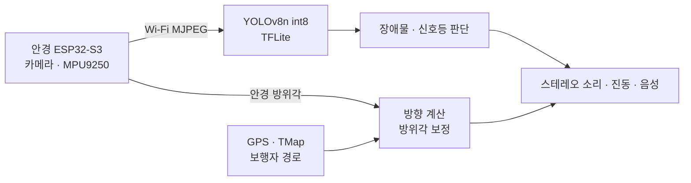

# BlindNav

**안경 카메라로 앞을 보고, 소리로 길을 알려 주는 보행 보조 앱**

시각장애인을 위한 AI 보행 보조 안경의 Android 앱입니다. 안경에 단 ESP32-S3 카메라 영상을 휴대폰이 받아 YOLO로 주변을 인식하고, 가야 할 방향과 가까운 장애물을 소리·진동·음성으로 알려 줍니다. 2026 ICT 융합 프로젝트 공모전 팀 출품작입니다.

| 이런 순간 | BlindNav |
|---|---|
| 목적지를 정할 때 | 목적지를 말하면 검색해서 TMap 보행자 경로를 찾음 |
| 걸어가는 동안 | 경로 방향을 좌우 스테레오 소리로 들려줌. 정면이면 가운데에서, 꺾어야 하면 그쪽에서 |
| 앞에 사람·차가 가까울 때 | 장애물 방향을 소리와 진동으로 알리고 "전방 5미터 이내 사람 주의" |
| 횡단보도 앞 | 신호등 색을 보고 "빨간불입니다. 정지하세요" / "초록불입니다. 건너가세요" |
| 경로에서 벗어났을 때 | 경로를 다시 찾아 안내 |
| 화면이 잘 안 보일 때 | 고대비 화면과 음성 안내 |

---

## 구성

| 경로 | 내용 |
|---|---|
| `ml/ObjectDetectorHelper.kt` | YOLOv8n int8 TFLite 추론. 640×640 입력, 출력 해석, NMS(IoU 0.45) |
| `ml/DetectionPolicy.kt` | 경고 대상(사람·차량·신호등 등), 최소 신뢰도 0.35, 화면 높이의 15%를 넘으면 가까운 물체 |
| `network/Esp32GlassesRepository.kt` | 안경 카메라 MJPEG 스트림 수신. 스트림이 안 되면 `/capture` 단일 이미지로 대체 |
| `network/TMapRepository.kt` | TMap 보행자 경로 |
| `sensors/` | GPS, 휴대폰 방향 센서, 안경 방위각 보정 값 저장 |
| `audio/AudioEngine.kt` | 경로 방향과 장애물 방향을 스테레오 소리로 합성 |
| `audio/TTSManager.kt`, `audio/VoiceCommandManager.kt` | 음성 안내, 음성으로 목적지 입력 |
| `haptics/HapticManager.kt` | 위험·일반 진동 |
| `ui/` | Jetpack Compose 화면, 고대비 모드, AI 민감도·방위각 보정 설정 |
| `ESP32-s3/` | 안경 펌웨어. 카메라 스트림(`:81/stream`, `/capture`), MPU9250 방위각(`/data`), OTA 업데이트 |
| `yolov8n_saved_model/` 등 | YOLOv8n을 TFLite로 바꾼 결과 (`yolov8n.pt` → ONNX → int8) |

앱 코드는 `app/src/main/java/com/example/blindproject1/` 아래에 있습니다.

### 안경 방위각 보정

안경 자이로가 가리키는 방향과 실제로 걷는 방향이 어긋날 수 있어서 화면에서 맞춥니다.

- ±1°·±5° 버튼으로 직접 조정하고, 방위각을 반전할 수 있음
- 경로 안내 중 정면을 보고 "현재 방향 = 경로 방향"을 누르면 자동으로 보정

---

## 실행

1. **안경 (ESP32-S3)**: `ESP32-s3/secrets.example.h`를 `secrets.h`로 복사해 Wi-Fi 정보를 넣고 `code.cpp`를 업로드합니다. 시리얼 모니터에 카메라 주소가 나옵니다.
2. **앱 주소 맞추기**: `ui/MainViewModel.kt`의 카메라 스트림(`:81/stream`)과 방위각(`/data`) 기본 주소를 안경의 IP로 바꿉니다.
3. **경로 안내**: TMap 보행자 경로 API 앱 키가 필요합니다.
4. Android Studio로 열어 실행합니다. Android 7.0(API 24) 이상, 카메라·위치·마이크·진동 권한을 씁니다.

YOLO 모델(`app/src/main/assets/yolov8n_int8.tflite`)은 저장소에 들어 있습니다.
